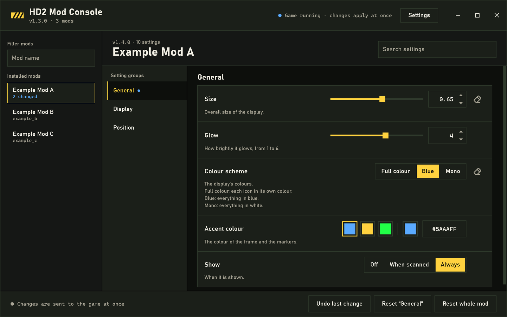
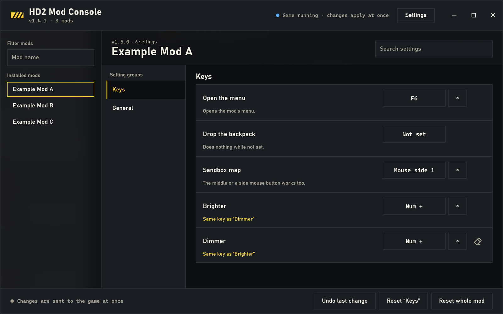
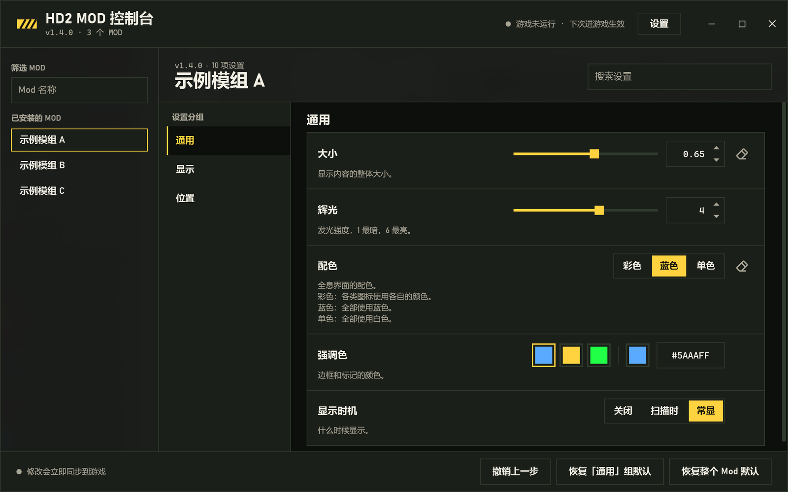
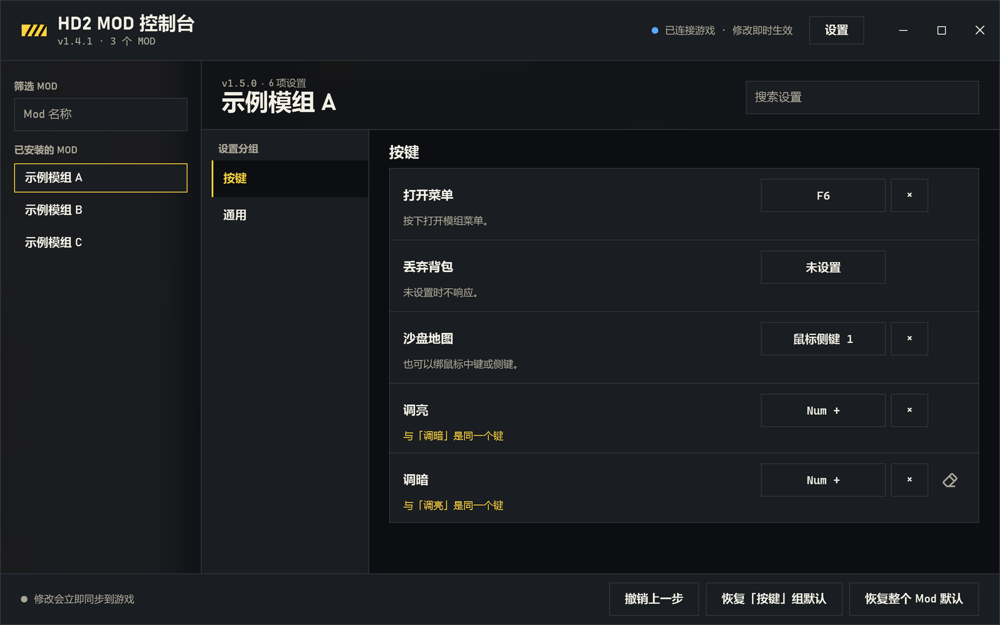

# HD2 Mod Setting GUI

A small window, outside the game, for editing a Helldivers 2 mod's settings.
A mod that supports it applies each change in the game within a second, so
you see the effect while you play.



Supported mods: **Super Holo HUD** 1.127.0 or later (named Super Holo Kit before; 1.125.1 and 1.126.0 work too).

One file of about 100 KB. It runs on the .NET Framework 4.8 that Windows 10
(1903 or later) and Windows 11 already have: nothing else to install.

[中文说明在下面](#中文)

## Use

1. Install a supported mod, start the game once (the mod writes its list of
   settings at launch).
2. Run `HD2 Mod Setting GUI.exe` (from this repository's Releases page).
3. Pick a group on the left, change a setting. The window writes it at
   once; the status line at the bottom says when the game has applied it.
   With the game closed, the change is kept and applies at the next launch.

Its header is its title bar: drag it to move the window, double-click it to
maximize; Windows' own snapping, animations and shadow are kept, and on
Windows 11 hovering the maximize button offers the snap layouts. A list
that appears in the folder later is loaded by itself; "Change folder" points
the window elsewhere and remembers it.

A key setting is set by clicking it and pressing the key (or the middle or a
side mouse button); Esc leaves it as it was, the cross clears it.



Search finds a setting in any group. A changed setting shows an eraser
that puts it back to its default; the footer undoes the last change, resets
the group shown or the whole mod. A slider's value can also be typed, or
stepped with the arrow keys or the small arrows beside it.

On Windows 11 (22H2 or later) the window's ground is acrylic: what is
behind it shows through, blurred. While you change a setting its mod marks
for it (a size, a colour, a position), everything but that setting's control
turns clear for a moment while the game runs, so with it in borderless
windowed mode you watch the change land in the game; it comes back 2.5 s after the last
change, or when you let go of a slider.

"Settings" in the header opens the window's own settings: the language
(at first Windows' own, then the one you chose), the folder with the
settings lists, the hiding above (on by default), and this repository's
address.

## What it touches

Two text files in the game's own settings folder,
`%APPDATA%\Arrowhead\Helldivers2`, and nothing else:

- `<mod>_options.json` -- the mod's list of settings, read only;
- `<mod>_settings.txt` -- the values, `key=value` lines, written whole in
  one write, its last line `#end` (a mod that catches it half written sees
  no `#end` and reads it again a moment later).

It also reads the end of `<mod>.log` for the status line, and the names in
Windows' list of running programs to see whether `helldivers2.exe` is
running. It does not open the game's process, read its memory, inject
anything, or go on the network.

If the game's Mod Options Menu holds a setting, that setting is set there;
the window shows it and says so.

## For mod authors

A mod takes part with two things:

1. At launch, write `<name>_options.json` into the folder above (only when
   it differs from what is there).

   > **Write it as early as you can: as your mod loads, not after your own
   > settings have loaded.** Until the file exists the window cannot show
   > your mod. Super Holo HUD wrote it after its settings' load at first,
   > and players waited about 45 s after starting the game. If part of the
   > list is only known later (`menu_owned`, once another menu has taken its
   > keys), write the list at load anyway and write it again then. The list
   > does not change while the game runs otherwise.

   For example:

   ```json
   {
     "title": "My Mod",
     "title_zh": "我的模组",
     "version": "my-mod-1.2.0",
     "settings": "my_mod_settings.txt",
     "pages": [ { "en": "General", "zh": "通用", "keys": ["size", "glow"] } ],
     "options": [
       { "key": "size", "type": "slider", "min": 0.2, "max": 1, "step": 0.05, "default": 0.8,
         "en": ["Size", "Overall size."], "zh": ["大小", "整体大小。"] },
       { "key": "glow", "type": "toggle", "default": true, "en": ["Glow", ""], "zh": ["辉光", ""] },
       { "key": "palette", "type": "choice", "default": 1,
         "choices": [["Full colour", "彩色"], ["Blue", "蓝"]], "en": ["Colours", ""], "zh": ["配色", ""] },
       { "key": "ring", "type": "color", "default": "#5ee7ff",
         "choices": [["#5ee7ff", "Cyan", "青"], ["#ffd23f", "Yellow", "黄"]], "en": ["Ring colour", ""], "zh": ["圆环颜色", ""] }
     ],
     "menu_owned": []
   }
   ```

   `type` is `toggle` (true / false), `choice` (1 .. the number of choices),
   `slider` (a number from `min` to `max` by `step`) or `color` (`#rrggbb`;
   its `choices` are presets, `[hex, en, zh]`, and any other colour can be
   picked or typed). `pages` lists the
   keys shown, page by page; without it every option is on one page.
   `menu_owned` lists keys another menu holds (shown, not editable).
   `title_zh` (optional) is the mod's name in the Chinese window.
   A description may be several lines: `\n` starts a new one.
   `type` `key` is a key: its value is the game's own name for a keyboard
   key (`q`, `f6`, `numpad 1`, `page up`, `left ctrl` -- what the game's
   `Keyboard.button_name` gives), `mouse 3` for the middle mouse button,
   `mouse 4` / `mouse 5` for the side ones, or empty for none. The player
   clicks the setting and presses the key; a key two of the mod's settings
   share is pointed out.
   `"peek": true` on an option asks the window to hide all but that
   option's control while it changes, so the player sees the game take it:
   for settings whose effect is to be looked at (sizes, colours, positions),
   not for ones read off a menu. The player can turn this off.

2. While the game runs, read `<name>_settings.txt` every second or so and
   apply any value that changed -- only a text that ends with the line
   `#end`. Keep the file open and read it again from its start (the window
   writes it in place), rather than opening it each time. Optionally log a line containing
   `settings window: applied` to `<name>.log` when you do; the window's
   status line looks for it.

## Build

C# and WPF on .NET Framework 4.8, no library beyond it (the tests use
xUnit). Build with the .NET SDK 8 or later:

```
build.bat
```

It runs the tests (`tests\Hd2ModSettingGui.Tests`), then writes
`release\HD2 Mod Setting GUI.exe`. `src\Hd2ModSettingGui\Core` holds the
files' protocol and has no window code in it; the tests run against it with
the list Super Holo HUD really writes (`tests\fixtures`).

## Licence

MIT -- see `LICENSE`.

---

## 中文

一个游戏外的小窗口，用来修改 Helldivers 2 模组的设置。支持本窗口的模组会在
一秒内把改动应用到游戏里，边玩边调就能看到效果。



支持的模组：**Super Holo HUD** 1.127.0 及以后（之前叫 Super Holo Kit，1.125.1、1.126.0 也能用）。

只有一个约 100 KB 的文件，用的是 Windows 10（1903 及以后）和 Windows 11
自带的 .NET Framework 4.8，不需要另外安装任何东西。

### 使用

1. 安装支持的模组，进一次游戏（模组会在启动时写出自己的设置清单）。
2. 运行 `HD2 Mod Setting GUI.exe`（在本仓库的 Releases 页下载）。
3. 修改设置。窗口会立即写入；底部状态栏会显示游戏何时已应用。游戏没开时，
   改动会保留，下次进游戏生效。

### 它会碰什么

只碰游戏自己的设置文件夹 `%APPDATA%\Arrowhead\Helldivers2` 里的两个文本文件：

- `<模组>_options.json`：模组的设置清单，只读；
- `<模组>_settings.txt`：设置值，每行 `key=value`，一次整份写入，最后一行是
  `#end`；模组如果正好读到写了一半的内容，没有 `#end` 就会等下一次再读。

另外会读 `<模组>.log` 的末尾来显示状态，并查看 Windows 正在运行的程序名单里
有没有 `helldivers2.exe`。它不打开游戏进程、不读游戏内存、不注入任何东西，
也不联网。

页头就是标题栏：拖动它移动窗口，双击最大化；Windows 自带的贴靠、动画和阴影都保留，
Windows 11 上把鼠标停在最大化按钮上会弹出分屏布局。文件夹里之后出现的设置清单会
自动载入；“更改文件夹”可以指向别的文件夹，并会记住。

按键设置：点一下再按下想要的键（也可以是鼠标中键或侧键）；Esc 取消，叉号清除。



左侧选分组，搜索框可以跨分组找设置；改过的设置旁有橡皮擦，点它恢复默认；底栏可以撤销上一步、
恢复本组默认或整个 Mod 默认。滑条的数值也可以直接输入，或用方向键、旁边的小箭头逐档调整。

在 Windows 11（22H2 及以后）上，窗口的底色是亚克力：后面的画面会模糊地透出来。
改动模组标注了需要的设置（比如大小、颜色、位置）时，除了正在改的那个控件，整个窗口会暂时
变成全透明（只在游戏运行时）；游戏用无边框窗口模式时，就能直接看到改动在游戏里的效果。最后一次改动 2.5 秒后，
或松开滑条后，窗口恢复原样。

页头的“设置”打开窗口自己的设置：语言（第一次跟随 Windows，之后沿用上次的选择）、设置列表所在
文件夹、上面说的隐藏窗口（默认开启），以及本仓库的地址。

如果某个设置由游戏内的 Mod Options Menu 管理，就要在那里修改；窗口会显示并注明。

### 给 mod 作者

接入方式见上面英文的 “For mod authors”。最重要的一点：

> **设置清单 `<名字>_options.json` 要尽早写：mod 一加载就写，不要等自己的设置读完。**
> 文件出现之前，窗口里看不到你的 mod。Super Holo HUD 起初是在读完设置后才写，
> 玩家开游戏后要等约 45 秒。如果清单里有一部分要晚些才知道（比如 `menu_owned`，
> 要等别的菜单接管完），也先在加载时写一份，到时候再补写一次。内容没变就不要重复写。

清单里可以加 `title_zh` 写模组的中文名，中文界面会显示它；没有就显示 `title`。

设置的说明可以分多行：在文字里写 `\n` 换行。

`type` 为 `key` 的设置是一个按键：值是游戏自己的键盘按键名（`q`、`f6`、`numpad 1`、`page up`、`left ctrl`，
即游戏 `Keyboard.button_name` 给出的名字），鼠标中键为 `mouse 3`，侧键为 `mouse 4` / `mouse 5`，空值表示未设置。
玩家点一下这项设置再按下按键即可；同一个模组里两项设置用了同一个键时，窗口会提示。

给设置项加上 `"peek": true`，改动它时窗口会只留下它的控件，玩家能直接看到游戏里的效果。
适合需要看效果的设置（大小、颜色、位置），不适合看菜单就能确认的设置。玩家可以在窗口设置里关掉。

### 构建

C# + WPF，基于 .NET Framework 4.8，除此之外不依赖任何库（测试用 xUnit）。
装好 .NET SDK 8 或更新版本后运行 `build.bat`：先跑测试，再生成
`release\HD2 Mod Setting GUI.exe`。

### 许可

MIT，见 `LICENSE`。
